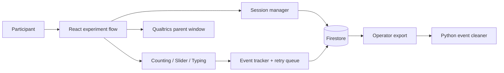

# BobaLab · Interactive Research Platform

**React · JavaScript · Firebase/Firestore · Qualtrics · Python ETL**

A browser-based behavioral experiment for studying how people plan, allocate time, and use automated assistance under task dependencies. Participants complete counting, slider-precision, and typing tasks while the platform coordinates practice, task allocation, timed rounds, checkpoints, and completion.

The engineering focus is the experiment infrastructure: keeping the task interface, session lifecycle, experimental condition, and event stream aligned throughout an interactive study.

## Engineering highlights

- **Stateful frontend:** a multi-stage React flow with task deferral, bonus rounds, persistent progress, timers, and interruption handling.
- **Reproducible task generation:** seeded slider targets and difficulty tiers spanning 100 levels per task type; other helper behaviors include controlled and stochastic responses.
- **Research instrumentation:** event records combine session IDs, relative/absolute timestamps, condition metadata, task responses, and assistance interactions.
- **Persistence and recovery:** Firestore session records, browser storage for continuity, and an in-memory retry queue for failed event writes.
- **System integration:** Qualtrics completion/progress messaging and operator tools to export events and transform them into analysis tables.

## Architecture



| Area | Entry point |
| --- | --- |
| Main experiment orchestration | [src/App.jsx](src/App.jsx) |
| Task UI and assistance behavior | [src/components/](src/components/) |
| Task patterns | [src/utils/patternGenerator.js](src/utils/patternGenerator.js) |
| Session lifecycle | [src/utils/sessionManager.js](src/utils/sessionManager.js) |
| Telemetry and retries | [src/utils/eventTracker.js](src/utils/eventTracker.js) |
| Survey integration | [src/utils/qualtricsMessenger.js](src/utils/qualtricsMessenger.js) |
| Data export and cleaning | [scripts/](scripts/) |
| Earlier embedded-survey implementations | [archive/](archive/) |

## Run locally

Use Node.js 20+ and a separate Firebase project configured for your own development environment.

```bash
npm ci
cp .env.example .env
# Fill VITE_FIREBASE_* using your own project's web configuration.
npm run dev
```

Firebase initialization happens when the application loads, so the interactive study flow requires configuration. `npm start` previews an existing build; it does not start the archived chat prototype.

```bash
npm test          # offline checks for task reproducibility and dependency behavior
npm run build    # production bundle
npm run preview  # inspect the built frontend locally
npm run lint     # includes known historical lint debt; see docs/DEVELOPMENT.md
```

## Research design

Task order changes the score: materials earn points, research modifies future materials gains, and engagement contributes compounding rewards. The interface also supports assistance and checkpoint conditions. The current login component is in internal testing mode; do not infer a randomized production assignment system from the historical condition configuration.

The active assistance logic is a controlled simulation used by the experiment, not a deployed LLM inference service. No throughput, availability, latency, or causal study-effect claims are established by this repository.

## Design notes

- [Architecture and tradeoffs](docs/ARCHITECTURE.md)
- [Development and validation](docs/DEVELOPMENT.md)
- [Firebase environment boundaries](docs/FIREBASE_SETUP.md)
- [Event pipeline](scripts/README.md)
- [Historical implementations](archive/README.md)

Participant rosters, event exports, installed dependencies, and generated bundles are excluded from the current source tree. Client-side research/admin controls are prototype controls, not server-enforced authorization. Existing permissive Firestore rules are a development artifact; configure and validate access rules before connecting any sensitive dataset. This cleanup does not deploy the application or its database rules.
